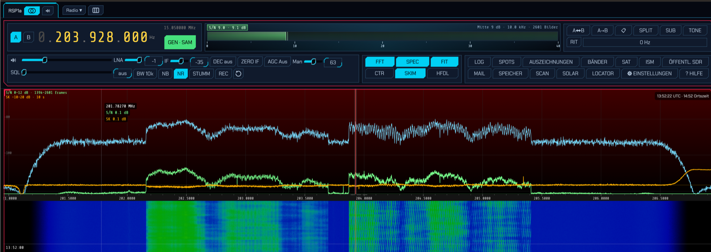
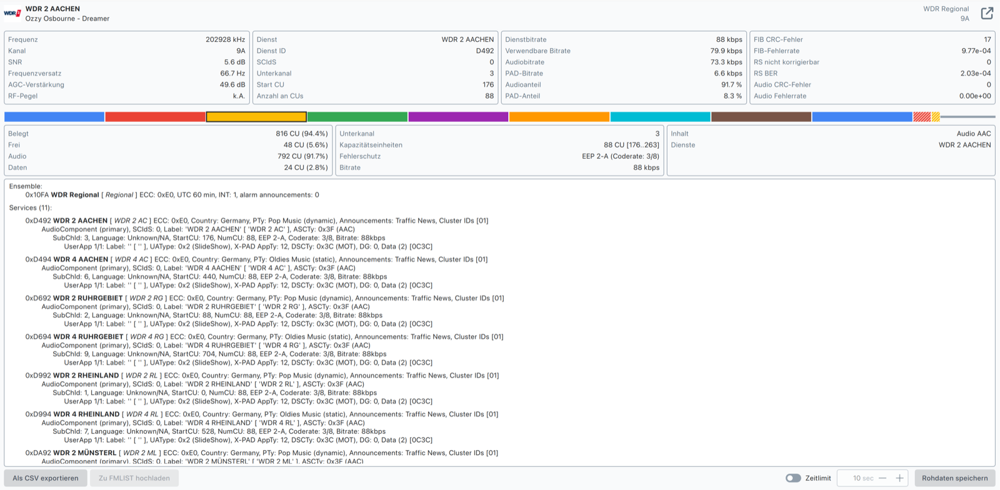
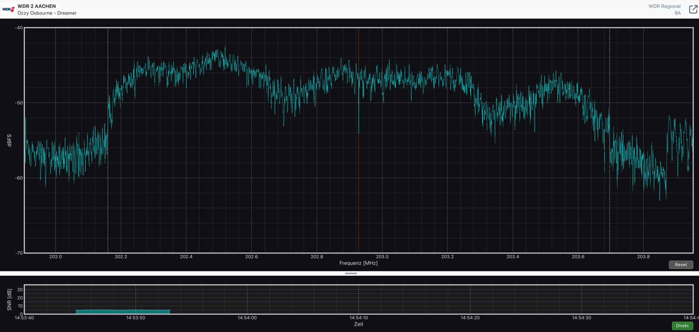

# TCI_transcode

**TCI_transcode lets programs written for the SDRconnect WebSocket API run on any receiver that speaks TCI.** The first TCI source is SDR Oxide; the first client is msdr, which in turn runs multimon-ng, dsd-fme, rtl_433, direwolf and jt9. The decoders stay separate programs; the bridge only translates.

```
SDR Oxide (TCI server, port 50001) ──► TCI_transcode ──► SDRconnect API (port 5454) ──► msdr, ft8-module, TandemSDR …
```

## What it does (0.1.0)

- **TCI in:** connects to the TCI server, reads its status (centre, VFO, mode, filter, IQ rate), subscribes IQ and RX audio after `ready;`, reconnects with backoff.
- **SDRconnect out (API 1.0.3):** `get_property`/`set_property` with string values, `property_changed` to every client, stream switches per connection; binary payload 1 (audio PCM16 stereo 48 kHz), 2 (IQ int16, sent in 20 ms frames so that a client's frame queue holds enough signal), 3 (spectrum, 512 uint8 bins at about 23 frames/s, computed from the IQ). `signal_power` and `signal_snr` come from the same FFT.
- **Who tunes:** `--lead frontend` (default) answers a client's tuning with the unchanged value; `--lead client` forwards it as `vfo:`, `dds:` or `modulation:`. The IQ rate (`device_sample_rate`) is the bridge's own subscription and is always the client's to choose.
- Properties without a TCI counterpart (squelch, AGC, NR, LNA, antenna, display range, filter bandwidth) are stored and echoed; they act on nothing.

- **rtl_tcp out (0.1.1, `--rtltcp`, default `127.0.0.1:1234`, `off` to disable):** the same IQ for programs written for an RTL-SDR on the network (AbracaDABra for DAB, SDR++, GQRX, welle.io, rtl_433 `-d rtl_tcp:…`; SoapySDR programs through SoapyRTLTCP). Header `RTL0` as an R820T with 29 gain steps; frequency (`0x01`) becomes `vfo:` and `dds:` when `--lead client`, sample rate (`0x02`) becomes `iq_samplerate:`; gain, AGC, ppm, bias-T and the rest are accepted and ignored. The IQ is resampled to exactly the client's rate (a TCI server snaps to an integer share of its hardware rate: SDR Oxide at 10 MS/s gives 2.000 for 2.048) by a 32-tap windowed-sinc, and scaled to unsigned 8 bit by a slow AGC (RMS −15 dBFS). Measured 2026-11-16 on SDR Oxide with a RSP1A at 10 MS/s: 2,048,350 samples/s over 30 s, longest pause 64 ms, nothing clipped.

Not yet: the workbench web page and process API, a file source, a second tuner, device selection, recording, profiles.

## Run

```sh
# SDR Oxide: the station radio serves TCI by default (127.0.0.1:50001). Tune as usual.
cargo run --release -- --tci 127.0.0.1:50001 --listen 127.0.0.1:5454 --iq-rate 500000
msdr --host 127.0.0.1 --port 5454
```

DAB with AbracaDABra: run the bridge with `--lead client` (the DAB program tunes the ensemble itself) and choose RTL-TCP, 127.0.0.1, port 1234 in AbracaDABra. Gain is set by hand in the TCI front end (TCI has no gain command; the client's gain steps are ignored).

Offset tuning (`--rtltcp-offset-khz`, default 1000): the hardware centre goes 1 MHz above the client's frequency so the receiver's DC spike stays outside the DAB block (±768 kHz); the bridge asks TCI for a stream wide enough (about 4.5 MS/s), shifts the client's frequency to zero from the centre the server reports, and cuts 2.048 MS/s out of it. The radio therefore needs a hardware rate of at least about 5 MS/s; below that the client falls back to tuning on the frequency (logged). First light 2026-11-16: SDR Oxide, RSP1A at 6 MS/s, gain set by hand; AbracaDABra 4.3.0 scanned Band III (59 services and more) and plays WDR 2 Aachen on channel 9A (202.928 MHz, ensemble WDR Regional): frequency offset 66.7 Hz, Reed-Solomon uncorrectable 0, audio CRC errors 0, SNR 5.6 dB. Shift −1,028,125 Hz (1 MHz plus SDR Oxide's own 28 kHz).

Use 500 kS/s for rtl_433 in msdr: it wants ±100 kHz around the VFO inside the IQ window, and SDR Oxide places the IQ centre beside the VFO (about 28 kHz off).

`RUST_LOG=tci_transcode=debug` logs the TCI conversation both ways and counts the stream frames.

`cargo run --release --example probe -- ws://127.0.0.1:5454 4` checks any SDRconnect endpoint (the bridge or a real SDRconnect): reads the properties msdr reads, then counts spectrum, IQ and audio frames for four seconds.

## Use case A: DAB+ from SDR Oxide in AbracaDABra (macOS)

Proof that the product works end to end, 2026-11-16, Mac mini M6 (32 GB, macOS 27), SDRplay RSP1A at 6 MS/s in SDR Oxide (TCI server on 127.0.0.1:50001, gain set by hand), TCI_transcode 0.1.1, AbracaDABra 4.3.0 as an rtl_tcp client.

```sh
tci_transcode --tci 127.0.0.1:50001 --lead client --rtltcp 127.0.0.1:1234
# AbracaDABra: Settings → Device → RTL TCP, 127.0.0.1, port 1234, Connect; then scan
```

- AbracaDABra sees a "Generic RTL2832U, R820T, uint8" and tunes Band III itself; the scan found 59 services and more.
- WDR 2 Aachen plays on channel 9A (202.928 MHz, ensemble WDR Regional, 11 services) with slideshow and labels: frequency offset 66.7 Hz, Reed-Solomon uncorrectable 0, audio CRC errors 0, SNR 5.6 dB.
- SDR Oxide sits 1 MHz above the channel (offset tuning keeps the RSP1A's DC spike out of the block); the bridge takes the 6 MS/s TCI stream, shifts the channel to zero and cuts out 2.048 MS/s.
- Load, per process in percent of one core: TCI_transcode about 10 % (25 MB), SDR Oxide about 29 %, AbracaDABra about 11 %; the whole chain uses about 4 % of the machine.







The TCI server needed one fix for this, in SDR Oxide itself: on macOS its client sockets were left non-blocking and dropped clients at high IQ rates (PR to SDR Oxide prepared).

## Limits

- **Gain:** TCI has no command for the receiver's gain. The gain steps an rtl_tcp client sends (AbracaDABra steps through them) are ignored; set the gain in the TCI front end by hand.
- **8 bit:** rtl_tcp carries unsigned 8-bit IQ. Enough for DAB+; tight for weak HF signals beside strong ones.
- **One radio, one IQ rate:** TCI has one IQ rate per radio, and the bridge one subscription. Two clients that want different rates (msdr at 500 kS/s and a DAB program at 2.048 MS/s) do not run on one bridge yet.
- **Retuning:** for a moment after a channel change the centre the server reports and the samples disagree, and the shift is wrong for a few blocks; a DAB scan rides over it.
- **Offset tuning** needs about 5 MS/s at the receiver; below that a client falls back to tuning on its frequency, DC spike included.
- Tested with SDR Oxide as the TCI server on macOS. Other TCI servers (ExpertSDR3, Thetis) follow the same protocol and are untested.

## tci_diag

`tci_diag` talks to any TCI server directly, without the bridge: `status` (status burst and summary), `watch` (every text line live, binary frames per stream), `iq --rate 500000 --secs 20` (delivered rate, frame sizes, longest pause), `ports --from 50001 --to 50010` (which ports serve TCI, with device and VFO), `spot --call … --mode … --hz … --color 0xAARRGGBB --text …` and `info "text"` (a grey INFO label at the VFO: the return path a decoder will use). `cargo run --release --bin tci_diag -- status`.

## Kit (in progress)

`kit/tci-kit.toml` holds the kit's settings, its rules in words (`[rules]`), one true/false line for each of msdr's 49 decoders, grouped by what msdr can run together, and each decoder's numbers (`[decoder_facts]`: path, receiver modes, minimum rate, width, programs).

- `python3 kit/check_config.py` checks the file and names every fault with its rule: raw IQ and audio decoders on together, audio decoders without a common receiver mode, an IQ rate below a decoder's minimum, a signal that leaves the IQ window, an unknown decoder id (with the nearest one), a missing program (warning). Exit 1 on any error; tests in `kit/test_check_config.py`.
- Profiles: `[decoders]` is profile *main* (the station radio). Each `[[profile]]` (name, tci, decoders, hz, optional iq_rate, listen, web_port) starts one more bridge and msdr instance from the same msdr install (`--web-port`, `--db`, `--settings`), so decoders of different groups or bands run at once, e.g. rtl_433 on 433 MHz beside PSK31 on 20 m. The checker applies the rules per profile and adds: unique names and ports, one IQ rate per TCI server.
- `kit/make_decoder_config.py`, run with msdr's Python, regenerates the file from msdr's own decoder registry and keeps the values and flags already set.

The start script that reads it (bridge, msdr, decoders, TCI SPOT back to the receiver) comes next and runs the check first.

## Test

`cargo test`: 22 unit tests (both protocols, state, spectrum) and one end-to-end run without hardware: a fake TCI server sends a tone 20 kHz above the centre, an SDRconnect client reads the properties, finds the tone in the right spectrum bin, receives IQ and retunes through the bridge.

## Sources

- SDRconnect WebSocket API 1.0.3, SDRplay: https://www.sdrplay.com/websocket-api
- TCI, Expert Electronics: https://github.com/ExpertSDR3/TCI
- msdr's notes on how the real SDRconnect server behaves: https://github.com/gdamdam/msdr (docs/research)

Own code only. No SDR Oxide, SDRconnect or msdr code is linked or copied.

## Licence

MIT, see `LICENSE`. The programs it talks to keep their own licences (SDR Oxide and msdr: GPL-3); TCI_transcode reaches them over the network only.
